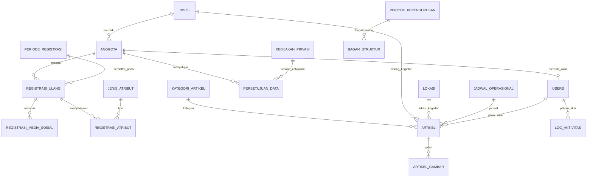

# SOFTWARE REQUIREMENTS SPECIFICATION (SRS)
## Sistem Informasi Manajemen Keanggotaan dan Website Resmi Mapala UNAND

---

### Informasi Dokumen
| Atribut | Keterangan |
| :--- | :--- |
| **Judul Dokumen** | Software Requirements Specification (SRS) - Sistem Informasi Manajemen Keanggotaan dan Website Resmi Mahasiswa Pecinta Alam Universitas Andalas |
| **Kode Proyek** | MAPALA-UNAND-2026 |
| **Mata Kuliah** | Manajemen Proyek Sistem Informasi (Kelompok 3) |
| **Anggota Tim** | Arifah Huwaina Azre (2411521003)<br>Farrel Ghufran Rahman (2411521009)<br>Talitha Nafisa Khairul (2411522007)<br>Rafa Gian Atthari (2411522014)<br>Muhammad Racha Ardiwinata (2411522020)<br>Muhammad Arrasyid (2411522027)<br>Syifa Khalishah Nugroho (2411522028) |
| **Versi Dokumen** | 1.0 |
| **Tanggal Terbit** | 10 November 2026 |
| **Status Dokumen** | Disetujui untuk Tahap Implementasi & Integrasi Database |

---

## DAFTAR ISI
1. [BAB I: Pendahuluan](#bab-i-pendahuluan)
   - 1.1 Tujuan Penulisan Dokumen
   - 1.2 Ruang Lingkup Sistem (Scope of Work)
   - 1.3 Definisi, Akronim, dan Singkatan
   - 1.4 Referensi Dokumen
   - 1.5 Struktur Dokumen
2. [BAB II: Deskripsi Umum Sistem (Overall Description)](#bab-ii-deskripsi-umum-sistem-overall-description)
   - 2.1 Perspektif Produk & Arsitektur Solusi
   - 2.2 Profil dan Karakteristik Pengguna
   - 2.3 Batasan Desain dan Implementasi (Design Constraints)
   - 2.4 Asumsi dan Ketergantungan (Assumptions & Dependencies)
3. [BAB III: Kebutuhan Antarmuka Eksternal (External Interface Requirements)](#bab-iii-kebutuhan-antarmuka-eksternal-external-interface-requirements)
   - 3.1 Antarmuka Pengguna (User Interface)
   - 3.2 Antarmuka Perangkat Keras (Hardware Interfaces)
   - 3.3 Antarmuka Perangkat Lunak (Software Interfaces)
   - 3.4 Antarmuka Komunikasi (Communication Interfaces)
4. [BAB IV: Kebutuhan Fungsional Sistem (Functional Requirements)](#bab-iv-kebutuhan-fungsional-sistem-functional-requirements)
   - 4.1 Modul Portal Publik (FR-01 s.d. FR-08)
   - 4.2 Modul Akun, Autentikasi, dan Hak Akses (FR-09 s.d. FR-15)
   - 4.3 Modul Kebijakan Privasi dan Direktori Anggota (FR-44 s.d. FR-47)
   - 4.4 Modul Dashboard dan Biodata Anggota (FR-16 s.d. FR-20)
   - 4.5 Modul Registrasi Ulang Anggota (FR-21 s.d. FR-27)
   - 4.6 Modul Dashboard Admin & Manajemen Anggota (FR-28 s.d. FR-38)
   - 4.7 Modul Content Management System / CMS Admin (FR-39 s.d. FR-43)
5. [BAB V: Kebutuhan Non-Fungsional (Non-Functional Requirements)](#bab-v-kebutuhan-non-fungsional-non-functional-requirements)
   - 5.1 Kinerja (Performance)
   - 5.2 Keamanan & Pelindungan Data Pribadi (Security & Privacy)
   - 5.3 Keandalan & Integritas Data (Reliability & Data Integrity)
   - 5.4 Kegunaan & Kemudahan Akses (Usability & Accessibility)
   - 5.5 Kemudahan Pemeliharaan (Maintainability)
   - 5.6 Pengindeksan Mesin Pencari (Search Engine Optimization)
6. [BAB VI: Spesifikasi Model Data & Relasi Database](#bab-vi-spesifikasi-model-data--relasi-database)
   - 6.1 Diagram Entitas Relasional (ERD Logic)
   - 6.2 Struktur 23 Tabel Relasional & 1 View Khusus
7. [BAB VII: Matriks Ketertelusuran Kebutuhan (Traceability Matrix)](#bab-vii-matriks-ketertelusuran-kebutuhan-traceability-matrix)

---

## BAB I: Pendahuluan

### 1.1 Tujuan Penulisan Dokumen
Dokumen *Software Requirements Specification* (SRS) ini disusun untuk menguraikan secara komprehensif seluruh spesifikasi kebutuhan fungsional dan non-fungsional dari **Sistem Informasi Manajemen Keanggotaan dan Website Resmi Mapala UNAND**. Dokumen ini menjadi rujukan teknis utama bagi tim pengembang, penguji sistem (QA), pengurus organisasi (klien), serta dosen pembimbing proyek dalam memastikan bahwa sistem yang dibangun memenuhi kebutuhan nyata organisasi serta siap untuk diintegrasikan secara menyeluruh dari antarmuka pengguna (landing page & admin SPA) ke basis data relasional MySQL.

### 1.2 Ruang Lingkup Sistem (Scope of Work)
Sistem ini mencakup pengembangan portal web terpadu yang memadukan profil publik organisasi dan sistem operasional internal keanggotaan:
1. **Portal Publik (Public Web Portal):** Menyajikan profil resmi, sejarah, visi-misi, bagan struktur kepengurusan periode aktif, dokumentasi ekspedisi/kegiatan, arsip prestasi, dan informasi kontak resmi sekretariat.
2. **Sistem Autentikasi & Akun Anggota:** Mekanisme login berbasis Nomor Register (`no_register`), gerbang perlindungan ganti kata sandi wajib pada login pertama, penandatanganan elektronik Kebijakan Privasi (UU PDP No. 27 Tahun 2022), dan pengelolaan akun mandiri.
3. **Portal Anggota (Member Area):** Pengelolaan profil data tetap, pelaksanaan registrasi ulang berkala tahunan (pembaruan domisili, kontak, profesi, dan status atribut lapangan), serta akses ke Direktori Anggota terbatas.
4. **Dashboard Pengelola (Admin Dashboard):** Pusat kendali bagi Bidang Kesekretariatan dan Bidang Organisasi untuk mengelola data anggota seumur hidup (± 355 anggota), impor massal dari Excel dengan pratinjau validasi, ekspor data CSV/Excel, cetak formulir biodata standar PDF, input registrasi mandiri/override, pemantauan kepatuhan registrasi ulang, pengaturan periode & master divisi/atribut, serta *Content Management System* (CMS) dinamis.

#### Batasan di Luar Cakupan (Out of Scope):
- Pengelolaan keuangan organisasi, kas, dan iuran keanggotaan.
- Pembuatan dan pengesahan Laporan Pertanggungjawaban (LPJ) kemahasiswaan/universitas.
- Sistem absensi kegiatan operasional dan kepanitiaan lapangan.
- Pendaftaran seleksi calon anggota baru (Open Recruitment siswa madya).
- Notifikasi otomatis melalui WhatsApp Gateway/SMS/Email otomatis pihak ketiga.
- Aplikasi mobile native (Android / iOS).

### 1.3 Definisi, Akronim, dan Singkatan
| Istilah / Akronim | Penjelasan |
| :--- | :--- |
| **Mapala UNAND** | Mahasiswa Pecinta Alam Universitas Andalas. |
| **No. Register** | Nomor pokok anggota unik seumur hidup (format: `MU [Nomor] [Divisi]`, contoh: `MU 325 Ltn.`, `MU 280 RGM`). Berfungsi sebagai username akun. |
| **Anggota Penuh** | Anggota yang telah menyelesaikan jenjang pendidikan keanggotaan dan memiliki nomor register resmi. |
| **Atribut Resmi** | Perlengkapan identitas resmi Mapala UNAND yang didata kepemilikannya tiap tahun, mencakup Topi Rimba dan Baju Lapangan (PDL). |
| **UU PDP** | Undang-Undang No. 27 Tahun 2022 tentang Pelindungan Data Pribadi di Indonesia. |
| **JWT** | *JSON Web Token*, mekanisme token terenkripsi untuk otentikasi sesi *stateless* pada REST API. |
| **RBAC** | *Role-Based Access Control*, pembatasan akses berdasarkan peran (`anggota` vs `admin`). |
| **SPA** | *Single Page Application*, aplikasi berbasis browser yang memperbarui antarmuka secara dinamis tanpa memuat ulang seluruh halaman. |
| **CMS** | *Content Management System*, antarmuka administrasi konten publik. |

### 1.4 Referensi Dokumen
1. *Product Requirements Document (PRD) Sistem Informasi Manajemen Keanggotaan dan Website Resmi Mapala Unand*, Versi 1.1 (10 November 2026).
2. *Rekap Bagian dan Menu Website Mapala UNAND*, Dokumen Arsitektur Menu & Integrasi Database (10 November 2026).
3. *Skema Database MySQL Sistem Mapala UNAND (Versi 2 - 23 Tabel + 1 View)* (`schema_mapala_unand..sql`).
4. Undang-Undang Republik Indonesia Nomor 27 Tahun 2022 tentang Pelindungan Data Pribadi.
5. Formulir Standar Biodata Anggota Penuh Mapala Universitas Andalas.

### 1.5 Struktur Dokumen
Dokumen ini disusun mengikuti adaptasi standar IEEE Std 830-1998 untuk spesifikasi kebutuhan perangkat lunak, terbagi ke dalam 7 bab utama mulai dari pendahuluan, deskripsi umum, kebutuhan antarmuka, kebutuhan fungsional mendalam, kebutuhan non-fungsional, arsitektur basis data, hingga matriks keterlacakan.

---

## BAB II: Deskripsi Umum Sistem (Overall Description)

### 2.1 Perspektif Produk & Arsitektur Solusi
Sistem Informasi Mapala UNAND dirancang sebagai sistem berbasis web dengan arsitektur *Client-Server* modular yang memisahkan lapisan penyajian (*presentation layer*), lapisan logika bisnis (*business logic layer*), dan lapisan penyimpanan data (*persistence layer*).

```
+--------------------------------------------------------------------------+
|                            LAPISAN KLIEN                                 |
|  +------------------------+  +-------------------+  +------------------+ |
|  | Website Profil Publik  |  |   Portal Anggota  |  |  Dashboard Admin | |
|  |  (HTML5/CSS3/Vanilla)  |  |    (Client SPA)   |  |   (Tailwind SPA) | |
|  +------------------------+  +-------------------+  +------------------+ |
+------------------------------------+-------------------------------------+
                                     | JSON over HTTPS (RESTful API)
+------------------------------------v-------------------------------------+
|                      LAPISAN SERVER (Node.js & Express)                  |
|  +--------------------+ +--------------------+ +-----------------------+ |
|  |   Auth Middleware  | |  Public Controller | |  Member Controller    | |
|  |   (JWT & RBAC)     | |  (Content & Feeds) | |  (Profile & Re-Reg)   | |
|  +--------------------+ +--------------------+ +-----------------------+ |
|  +--------------------+ +--------------------+ +-----------------------+ |
|  |  Admin Controller  | | File Upload Handler| | Export/Report Service | |
|  |  (Members & CMS)   | | (Multer Storage)   | | (ExcelJS & PDFKit)    | |
|  +--------------------+ +--------------------+ +-----------------------+ |
+------------------------------------+-------------------------------------+
                                     | MySQL Connection Pool (InnoDB)
+------------------------------------v-------------------------------------+
|                     LAPISAN BASIS DATA (MySQL 8.0+)                      |
|  +---------------------------------------------------------------------+ |
|  | 23 Tabel Relasional (users, anggota, registrasi_ulang, artikel, dll) | |
|  | 1 View Resmi: v_direktori_anggota (Enforcing Privacy by Design)      | |
|  +---------------------------------------------------------------------+ |
+--------------------------------------------------------------------------+
```

### 2.2 Profil dan Karakteristik Pengguna
| Peran Pengguna | Deskripsi Pengguna | Tingkat Kemahiran Teknis | Hak Akses Utama |
| :--- | :--- | :--- | :--- |
| **Pengunjung Publik** | Mahasiswa UNAND, calon anggota, masyarakat umum, mitra pecinta alam, sponsor. | Bervariasi (Umum) | Mengakses beranda, sejarah, artikel/ekspedisi, daftar prestasi, struktur pengurus aktif, dan kontak sekretariat. |
| **Anggota / Alumni** | Anggota penuh Mapala UNAND lintas angkatan (1980-an hingga saat ini, ± 355 orang). | Beragam (sebagian senior minim literasi digital) | Melakukan login, ganti kata sandi, persetujuan privasi, melihat biodata, pengisian registrasi ulang tahunan, dan pencarian direktori domisili sesama anggota. |
| **Administrator (BPH & Kesekretariatan)** | Pengurus aktif Bidang Organisasi dan Kesekretariatan yang diberi wewenang oleh Ketua Umum. | Menengah (Bukan programmer) | Manajemen penuh data anggota, impor massal Excel, ekspor laporan, reset password anggota, monitoring registrasi tahunan, pengelolaan periode/divisi, dan manajemen konten CMS website. |

### 2.3 Batasan Desain dan Implementasi (Design Constraints)
1. **Bahasa Pemrograman & Runtime:** Node.js (v18.x LTS atau lebih tinggi) menggunakan framework Express.js.
2. **Basis Data:** MySQL 8.0+ atau MariaDB 10.5+ dengan storage engine InnoDB, format karakter `utf8mb4`, dan collation `utf8mb4_unicode_ci`.
3. **Penyimpanan Berkas (File Storage):** Berkas unggahan (foto profil, foto atribut, bagan struktur pengurus, gambar artikel) disimpan di server lokal (`public/uploads/`) dengan pembatasan ukuran maksimal:
   - Foto Profil & Atribut Anggota: ≤ 2 MB (format JPG/PNG/WEBP).
   - Gambar Bagan Struktur Organisasi: ≤ 5 MB (format JPG/PNG/WEBP).
   - Gambar Artikel & Prestasi: ≤ 3 MB per berkas.
4. **Keamanan Kredensial:** Kata sandi disimpan menggunakan fungsi hash satu arah `bcrypt` (work factor 10). Kata sandi teks asli (plain text) tidak pernah disimpan atau ditampilkan kepada admin.
5. **Kepatuhan Regulasi:** Penerapan kepatuhan UU No. 27 Tahun 2022 tentang Pelindungan Data Pribadi melalui *Data Minimization* pada antarmuka publik dan Direktori Anggota.

### 2.4 Asumsi dan Ketergantungan (Assumptions & Dependencies)
1. **Format Identitas:** Nomor Register anggota bersifat unik dan tidak akan berubah seumur hidup.
2. **Ketersediaan Data Awal:** Pengurus organisasi menyediakan data induk awal ± 355 anggota dalam berkas Microsoft Excel (.xlsx/.csv) dengan format kolom yang telah disepakati.
3. **Jadwal Registrasi:** Registrasi ulang dilaksanakan secara periodik satu kali per tahun kalender yang dibuka dan ditutup secara manual oleh Administrator.
4. **Integritas Koneksi:** Aplikasi dioperasikan secara daring (*web-based online*) sehingga pengguna membutuhkan koneksi internet aktif.

---

## BAB III: Kebutuhan Antarmuka Eksternal

### 3.1 Antarmuka Pengguna (User Interface)
1. **Responsivitas:** Tampilan harus responsif dan adaptif (*mobile-friendly*) untuk berbagai resolusi layar (Ponsel: 360px - 480px, Tablet: 768px - 1024px, Desktop: ≥ 1280px).
2. **Aksesibilitas & Tipografi:** Warna kontras tinggi bernuansa alam (Forest Green, Earth Slate, Safety Orange) dan tipografi yang jelas (*legible font family* seperti Inter/Roboto) guna mempermudah pembacaan oleh anggota senior.
3. **Struktur Tata Letak Utama:**
   - **Antarmuka Publik:** Navbar atas statis, Breadcrumb navigasi, Hero section, Konten grid/carousel, dan Footer informasi lengkap.
   - **Portal Anggota:** Sidebar kiri menu navigasi, kartu identitas, indikator status registrasi, form step-by-step, dan tabel direktori dengan filter.
   - **Dashboard Admin:** Sidebar navigasi hierarkis, panel ringkasan kartu analitik, data-table dengan pagination/filter/pencarian instan, modal form input, serta tab interaktif CMS.

### 3.2 Antarmuka Perangkat Keras (Hardware Interfaces)
- **Sisi Klien (Pengguna):**
  - Perangkat: Smartphone, Tablet, Laptop, atau PC Desktop.
  - Memori RAM: Minimal 2 GB.
  - Resolusi Layar: Minimal 360 x 640 piksel.
- **Sisi Server (Hosting Web):**
  - CPU: Minimal 1 vCPU (direkomendasikan 2 vCPU).
  - RAM: Minimal 1 GB (direkomendasikan 2 GB).
  - Ruang Penyimpanan: Minimal 10 GB SSD (untuk OS, aplikasi, basis data, dan media berkas).

### 3.3 Antarmuka Perangkat Lunak (Software Interfaces)
- **Sistem Operasi Server:** Linux (Ubuntu 22.04 LTS / Debian 11+) atau Windows Server 2022.
- **Web Browser Pengguna:** Google Chrome (v100+), Mozilla Firefox (v100+), Apple Safari (v15+), Microsoft Edge (v100+).
- **Library & Dependency Kunci:**
  - `mysql2`: Koneksi basis data asynchronous dengan Connection Pool.
  - `bcryptjs`: Pengacakan dan verifikasi kata sandi.
  - `jsonwebtoken (jwt)`: Manajemen token autentikasi.
  - `multer`: Penanganan multipart form data untuk pengunggahan media.
  - `exceljs` / `xlsx`: Parser impor dan generator ekspor berkas Excel.
  - `pdfkit`: Pembuatan dokumen formulir biodata standar PDF.

### 3.4 Antarmuka Komunikasi (Communication Interfaces)
- Protokol Komunikasi: HTTP/1.1 dan HTTPS (Port 80 dan 443).
- Format Serialisasi Data: `application/json` (RESTful API).
- Pengunggahan Berkas: `multipart/form-data`.
- Pengunduhan Dokumen: `application/vnd.openxmlformats-officedocument.spreadsheetml.sheet`, `text/csv`, dan `application/pdf`.

---

## BAB IV: Kebutuhan Fungsional Sistem (Functional Requirements)

### 4.1 Modul Portal Publik
| Kode FR | Nama Kebutuhan | Deskripsi Spesifikasi Teknis | Prioritas |
| :--- | :--- | :--- | :---: |
| **FR-01** | Akses Halaman Tanpa Login | Sistem menyediakan akses bebas tanpa autentikasi untuk halaman Beranda, Tentang Kami, Struktur Organisasi, Kegiatan & Artikel, Detail Artikel, Prestasi, dan Kontak. | **[M]** |
| **FR-02** | Halaman Beranda Dinamis | Menampilkan profil singkat, filter cepat (divisi, lokasi, jadwal), statistik organisasi dari tabel `statistik_beranda`, carousel artikel terbaru berstatus terbit (`status_publikasi = 'terbit'`), kartu divisi, sorotan prestasi (`is_sorotan = 1`), serta tombol menuju portal login. | **[M]** |
| **FR-03** | Halaman Tentang Kami | Menampilkan narasi sejarah pendirian, nilai visi organisasi, daftar poin-poin misi dari tabel `misi_poin`, serta teks resmi Kode Etik Pencinta Alam Indonesia. | **[M]** |
| **FR-04** | Tampilan Struktur Organisasi | Menampilkan gambar bagan struktur kepengurusan periode berjalan (`is_aktif = 1` pada tabel `bagan_struktur` dan `is_current = 1` pada `periode_kepengurusan`), dilengkapi keterangan judul bagan dan label periode. | **[M]** |
| **FR-05** | Eksplorasi Kegiatan & Artikel | Menyajikan daftar kegiatan/artikel yang telah diterbitkan dengan fitur pencarian teks penuh (*full-text search* pada judul dan ringkasan) serta penyaringan berdasarkan kategori (`kategori_artikel`). Halaman detail menyajikan teks lengkap, foto sampul, dan galeri pendukung. | **[M]** |
| **FR-06** | Halaman Prestasi Organisasi | Menampilkan rekam jejak pencapaian dan penghargaan dari tabel `prestasi` diurutkan berdasarkan tahun terbaru, memuat judul, kategori, deskripsi, label info kegiatan, dan dokumentasi foto. | **[M]** |
| **FR-07** | Halaman & Informasi Kontak | Menampilkan kanal komunikasi resmi: email sekretariat, nomor WhatsApp resmi, alamat kantor PKM Unand, dan tautan media sosial dari tabel `konten_statis` dan `tautan_sosial`. | **[M]** |
| **FR-08** | Proteksi Privasi Publik | Sistem menjamin tidak ada data pribadi anggota (nomor register, nomor HP, alamat, golongan darah, nama orang tua) yang terekspos pada seluruh halaman publik. | **[M]** |

### 4.2 Modul Akun, Autentikasi, dan Hak Akses
| Kode FR | Nama Kebutuhan | Deskripsi Spesifikasi Teknis | Prioritas |
| :--- | :--- | :--- | :---: |
| **FR-09** | Otentikasi Login Pengguna | Sistem memvalidasi kredensial pengguna menggunakan username (No. Register untuk anggota, username khusus untuk admin) dan password. Verifikasi dilakukan terhadap tabel `users`. Sesi sukses menghasilkan JSON Web Token (JWT). | **[M]** |
| **FR-10** | Pembuatan Akun Terpusat | Akun anggota dibuat secara terpusat oleh Admin (melalui input manual atau impor massal). Setiap anggota memiliki satu akun tertaut unik (`users.anggota_id`) dengan password acak/default. | **[M]** |
| **FR-11** | Wajib Ganti Password Pertama Kali | Pengguna dengan atribut `must_change_password = 1` secara paksa diarahkan ke layar ganti kata sandi sebelum diizinkan mengakses menu dashboard anggota lainnya. | **[M]** |
| **FR-12** | Pembaruan Kata Sandi Mandiri | Pengguna yang telah login dapat mengganti kata sandi akunnya melalui menu Pengaturan Akun dengan memasukkan kata sandi lama yang valid dan kata sandi baru (minimal 6 karakter). | **[M]** |
| **FR-13** | Reset Password oleh Admin | Administrator memiliki hak untuk menyetel ulang kata sandi anggota yang lupa/terkunci menjadi kata sandi awal sementara, dan secara otomatis menetapkan `must_change_password = 1`. Admin tidak dapat melihat kata sandi pengguna. | **[M]** |
| **FR-14** | Sesi dan Logout | Pengguna dapat mengakhiri sesi secara aman. Token JWT memiliki masa kedaluwarsa 12 jam. Sesi yang tidak aktif akan diblokir saat token kedaluwarsa. | **[M]** |
| **FR-15** | Role-Based Access Control (RBAC) | Sistem secara ketat menolak permintaan dari pengguna dengan `role = 'anggota'` terhadap endpoint atau rute `/admin/*` dan `/api/admin/*` dengan kode status HTTP 403 Forbidden. | **[M]** |

### 4.3 Modul Kebijakan Privasi dan Direktori Anggota
| Kode FR | Nama Kebutuhan | Deskripsi Spesifikasi Teknis | Prioritas |
| :--- | :--- | :--- | :---: |
| **FR-44** | Persetujuan Kebijakan Privasi | Pada login pertama setelah penggantian kata sandi, anggota disajikan naskah Kebijakan Privasi & Persetujuan Penggunaan Data aktif (`kebijakan_privasi.aktif = 1`). Anggota wajib mencentang persetujuan sebelum dapat melanjutkan ke sistem. | **[M]** |
| **FR-45** | Pencatatan Riwayat Persetujuan | Sistem mencatat persetujuan ke tabel `persetujuan_data` (`anggota_id`, `kebijakan_id`, `disetujui_at`). Jika admin menerbitkan versi kebijakan baru, sistem akan mewajibkan anggota menandatangani ulang persetujuan. | **[S]** |
| **FR-46** | Akses Direktori Terbatas | Sistem menyediakan menu Direktori Anggota khusus bagi anggota aktif yang telah menyetujui kebijakan aktif. Data diambil eksklusif dari view database `v_direktori_anggota` yang membatasi informasi HANYA pada 5 atribut: **Nama, No. Register, No. HP, Golongan Darah, dan Alamat Rumah/Domisili Saat Ini**. | **[M]** |
| **FR-47** | Pencarian & Filter Direktori | Anggota dapat mencari rekan anggota pada direktori berdasarkan nama atau No. Register, serta memfilter berdasarkan wilayah domisili (Kota/Kabupaten, Provinsi) dan Golongan Darah (A, B, AB, O) untuk keperluan darurat/donor darah. | **[M]** |

### 4.4 Modul Dashboard dan Biodata Anggota
| Kode FR | Nama Kebutuhan | Deskripsi Spesifikasi Teknis | Prioritas |
| :--- | :--- | :--- | :---: |
| **FR-16** | Dashboard Anggota | Menampilkan ringkasan kartu profil anggota, status kepatuhan registrasi ulang periode berjalan (Belum / Sudah Registrasi beserta tanggal submit), dan notifikasi kelengkapan profil. | **[M]** |
| **FR-17** | Pengisian Profil Awal | Anggota diarahkan melengkapi data profil tetap yang belum terisi: Tempat/Tanggal Lahir, Golongan Darah, Nama Ayah, dan Nama Ibu. Nilai `profil_lengkap` otomatis berubah menjadi 1 jika seluruh data wajib terisi. | **[M]** |
| **FR-18** | Tinjauan Biodata Saya | Anggota dapat melihat profil tetap dan data registrasi terkini miliknya. Anggota diperbolehkan memperbarui data tetap (kecuali No. Register dan Angkatan yang dikunci untuk admin). | **[M]** |
| **FR-19** | Validasi Masukan Data | Sistem memvalidasi kelayakan masukan: format tanggal (YYYY-MM-DD), enum golongan darah ('A','B','AB','O'), panjang No. HP (10-15 digit), dan validitas sintaks email. | **[M]** |
| **FR-20** | Pencatatan Jejak Waktu | Setiap pembaruan profil secara otomatis memperbarui timestamp `updated_at` pada tabel `anggota`. | **[S]** |

### 4.5 Modul Registrasi Ulang Anggota
| Kode FR | Nama Kebutuhan | Deskripsi Spesifikasi Teknis | Prioritas |
| :--- | :--- | :--- | :---: |
| **FR-21** | Pembatasan Masa Registrasi | Formulir Registrasi Ulang hanya dapat diakses dan disimpan jika terdapat periode registrasi aktif dengan status `status = 'buka'` pada tabel `periode_registrasi`. | **[M]** |
| **FR-22** | Formulir Registrasi Berkala | Menyajikan data profil tetap dalam mode *read-only* terkunci, dan menyediakan kolom isian berkala: Foto Diri Terbaru, Alamat Rumah Lengkap, Kota/Kabupaten, Provinsi, Pekerjaan, No. HP, Email Aktif, Alamat Orang Tua, Akun Media Sosial, dan Kepemilikan Atribut. | **[M]** |
| **FR-23** | Auto-fill Cerdas & Reset Atribut | Form otomatis terisi data dari periode sebelumnya agar anggota cukup mengoreksi perubahan. Khusus foto atribut, data hanya terisi otomatis jika masih dalam periode tahun yang sama; bila berganti tahun, anggota wajib mengunggah foto atribut baru. | **[M]** |
| **FR-24** | Pencatatan Status Registrasi | Keberhasilan penyimpanan formulir langsung mencatat baris baru pada tabel `registrasi_ulang` dengan penanda waktu `submitted_at` dan `sumber_input = 'mandiri'`. | **[M]** |
| **FR-25** | Pembaruan Data Selama Periode Buka | Anggota dapat memperbarui isian registrasi ulangnya selama periode tahun berjalan masih berstatus 'buka'. Sistem memperbarui kolom `updated_at`. | **[S]** |
| **FR-26** | Riwayat Registrasi Tahunan | Anggota dapat melihat arsip riwayat registrasi ulang periode-periode sebelumnya dalam mode baca saja (*read-only*). | **[S]** |
| **FR-27** | Validasi Pengunggahan Berkas | Sistem memvalidasi ekstensi berkas foto (.jpg, .jpeg, .png, .webp) dengan ukuran maksimal 2 MB. Berkas yang tidak valid akan ditolak dengan pesan kesalahan spesifik. | **[M]** |

### 4.6 Modul Dashboard Admin & Manajemen Anggota
| Kode FR | Nama Kebutuhan | Deskripsi Spesifikasi Teknis | Prioritas |
| :--- | :--- | :--- | :---: |
| **FR-28** | Statistik Analitik Dashboard | Menampilkan kartu total anggota terdaftar, jumlah sudah vs belum registrasi periode berjalan, persentase kepatuhan, distribusi anggota per divisi, dan sebaran angkatan. | **[M]** |
| **FR-29** | Pencarian & Filter Anggota | Admin dapat mencari anggota berdasarkan Nama atau No. Register, serta memfilter berdasarkan Divisi, Angkatan, Domisili (Provinsi/Kota), dan Status Registrasi Periode Berjalan. | **[M]** |
| **FR-30** | Operasi Data Anggota (CRUD) | Admin dapat menambah anggota baru secara manual, melihat profil detail, mengubah data anggota, dan mengaktifkan/menonaktifkan status anggota (`is_active`). | **[M]** |
| **FR-31** | Impor Massal Excel (Preview & Commit) | Admin dapat mengunggah berkas template Excel/CSV berisi daftar anggota. Sistem memvalidasi format, menampilkan tinjauan data valid vs duplikat/salah (*preview*), lalu memproses penyimpanan batch (*commit*) dengan transaksi atomik. | **[M]** |
| **FR-32** | Input Registrasi Pengurus (Override) | Admin dapat mengisikan data registrasi ulang atas nama anggota (misal anggota senior yang mengirimkan data via WhatsApp/formulir fisik). Sistem menandai `sumber_input = 'admin'` dan mencatat ID admin pada `diinput_oleh`. | **[M]** |
| **FR-33** | Pengaturan Periode, Divisi & Atribut | Admin dapat membuat periode registrasi baru, membuka/menutup status periode, mengelola master divisi, dan mengelola daftar master jenis atribut (`jenis_atribut`). | **[M]** |
| **FR-34** | Monitoring Registrasi Ulang | Halaman khusus untuk memantau status anggota yang sudah vs belum registrasi ulang pada periode tertentu, lengkap dengan tanggal submit dan indikator input (mandiri/admin). | **[M]** |
| **FR-35** | Ekspor Laporan Data (CSV/Excel) | Admin dapat mengekspor data anggota dan hasil registrasi ulang ke format berkas Excel (.xlsx) atau CSV berdasarkan parameter filter dan periode yang dipilih. | **[M]** |
| **FR-36** | Pencatatan Log Audit Aktivitas | Seluruh aksi krusial admin (tambah anggota, ubah data, ganti status, reset password, impor, input registrasi) dicatat ke tabel `log_aktivitas` memuat user ID, jenis aksi, nama entitas, data lama (JSON), data baru (JSON), IP address, dan timestamp. | **[S]** |
| **FR-37** | Pintasan WhatsApp Cepat | Admin dapat mengklik ikon nomor HP anggota untuk langsung membuka tautan percakapan WhatsApp Web/App (`https://wa.me/...`). | **[C]** |
| **FR-38** | Cetak Formulir Biodata Standar (PDF) | Sistem menghasilkan berkas PDF standar cetak satu lembar yang memuat biodata lengkap anggota sesuai format resmi formulir Biodata Anggota Penuh Mapala UNAND. | **[C]** |

### 4.7 Modul Content Management System / CMS Admin
| Kode FR | Nama Kebutuhan | Deskripsi Spesifikasi Teknis | Prioritas |
| :--- | :--- | :--- | :---: |
| **FR-39** | Manajemen Artikel & Ekspedisi | CRUD artikel publik: Judul, Slug, Kategori, Divisi, Lokasi, Jadwal, Ringkasan, Konten Lengkap, Tim/Capaian, Tanggal Kegiatan, Status Publikasi ('draf' / 'terbit'), foto sampul, dan galeri pendukung. | **[M]** |
| **FR-40** | Manajemen Bagan Struktur | Admin dapat memilih periode kepengurusan aktif, mengunggah berkas gambar bagan struktur organisasi resmi (JPG/PNG/WEBP maks 5 MB), memberi judul/keterangan bagan, dan mempublikasikannya. | **[M]** |
| **FR-41** | Manajemen Rekam Prestasi | Admin dapat menambah, mengubah, dan menghapus catatan prestasi organisasi: Tahun, Kategori, Judul, Deskripsi, 2 Label Info, Dokumentasi Foto, serta pengaturan Sorotan Beranda (`is_sorotan`). | **[M]** |
| **FR-42** | Manajemen Konten Statis & Kontak | Admin dapat memperbarui narasi sejarah, visi, teks kode etik, kontak sekretariat (email, whatsapp, alamat), poin misi (`misi_poin`), kartu statistik (`statistik_beranda`), dan tautan medsos (`tautan_sosial`). | **[S]** |
| **FR-43** | Konfirmasi Tindakan & Notifikasi | Sistem selalu menampilkan dialog konfirmasi modal sebelum menghapus data atau menonaktifkan status, serta menyajikan toast notification responsif atas setiap keberhasilan/kegagalan aksi. | **[S]** |

---

## BAB V: Kebutuhan Non-Fungsional (Non-Functional Requirements)

### 5.1 Kinerja (Performance)
- **NFR-01:** Seluruh halaman publik dan pemanggilan API konten harus dapat dimuat dalam waktu **≤ 3 detik** pada kondisi jaringan seluler 4G normal dengan latensi rata-rata.
- **NFR-09:** Sistem mampu melayani minimal **500 akun terdaftar** dan mendukung hingga **50 pengguna bersamaan (*concurrent users*)** tanpa terjadi degradasi kinerja atau waktu tunggu di atas 5 detik.

### 5.2 Keamanan & Pelindungan Data Pribadi (Security & Privacy)
- **NFR-04:** Seluruh saluran komunikasi data wajib dienkripsi menggunakan protokol HTTPS (TLS 1.3). Seluruh kata sandi pengguna wajib dienkripsi satu arah menggunakan fungsi hash `bcrypt` (salt rounds minimal 10).
- **NFR-05:** Mekanisme otorisasi ketat berbasis peran (*Role-Based Access Control*). Biodata sensitif anggota dilarang keras dapat diakses tanpa token autentikasi valid. Anggota biasa hanya diperbolehkan mengakses data rekannya sebatas data pada tabel view `v_direktori_anggota` dari anggota yang telah menyatakan persetujuan data aktif.
- **NFR-06:** Sistem menerapkan proteksi serangan *brute-force* pada antarmuka login. Apabila terjadi kegagalan login berturut-turut sebanyak 5 kali, akun akan terkunci sementara selama 15 menit melalui kolom `locked_until` pada tabel `users`.
- **NFR-07:** Implementasi prinsip *Privacy by Design* sesuai mandat Undang-Undang No. 27 Tahun 2022 tentang Pelindungan Data Pribadi (UU PDP). Setiap pemrosesan data anggota harus didahului persetujuan eksplisit (*explicit consent*) yang tersimpan dalam log audit.

### 5.3 Keandalan & Integritas Data (Reliability & Data Integrity)
- **NFR-08:** Integritas referensial data dijamin pada level basis data MySQL menggunakan foreign key constraint:
  - Nomor Register anggota dijamin unik seumur hidup (`no_register UNIQUE`).
  - Relasi `registrasi_ulang` terhadap `anggota` dan `periode_registrasi` menggunakan aturan `ON DELETE RESTRICT` guna menjamin riwayat registrasi tahunan tidak hilang atau terhapus tak sengaja.
  - Aturan "hanya satu bagan struktur aktif", "hanya satu versi kebijakan privasi aktif", dan "hanya satu periode kepengurusan berjalan" dipaksakan secara ketat pada skema database menggunakan kolom virtual terindeks `UNIQUE`.

### 5.4 Kegunaan & Kemudahan Akses (Usability & Accessibility)
- **NFR-02:** Antarmuka responsif secara penuh, kompatibel dengan browser modern (Google Chrome, Mozilla Firefox, Microsoft Edge, Safari) tanpa menimbulkan pergeseran tata letak elemen (*layout shifting*).
- **NFR-03:** Antarmuka ramah pengguna bagi anggota senior: seluruh istilah dan petunjuk menggunakan Bahasa Indonesia yang komunikatif, kontras warna memenuhi standar WCAG AA, ukuran font tombol dan formulir mudah ditekan pada perangkat layar sentuh, dan alur registrasi ulang dapat diselesaikan dalam waktu **≤ 10 menit**.

### 5.5 Kemudahan Pemeliharaan (Maintainability)
- **NFR-11:** Seluruh konten tekstual, foto kegiatan, bagan pengurus, dan parameter operasional dapat dikelola secara mandiri oleh Administrator melalui antarmuka CMS tanpa memerlukan perubahan atau intervensi kode sumber (*zero code maintenance*). Kode program ditulis dengan pola MVC (*Model-View-Controller*) modular dan terdokumentasi rapi.

### 5.6 Pengindeksan Mesin Pencari (SEO)
- **NFR-12:** Seluruh halaman publik dilengkapi dengan struktur elemen HTML semantik, judul halaman spesifik (*meta title*), deskripsi meta ringkas (*meta description*), serta tag Open Graph (OG Tag) agar terindeks optimal di mesin pencari (Google Search) dan tampil rapi saat tautan dibagikan di media sosial.

---

## BAB VI: Spesifikasi Model Data & Relasi Database

### 6.1 Diagram Konseptual Relasi Data
Basis data `mapala_unand` dirancang dengan storage engine InnoDB, terdiri dari **23 tabel relasional** dan **1 view khusus** yang terbagi ke dalam 5 domain fungsional:
1. **Domain Akun & Keanggotaan:** `divisi`, `anggota`, `users`.
2. **Domain Registrasi Ulang:** `periode_registrasi`, `jenis_atribut`, `registrasi_ulang`, `registrasi_media_sosial`, `registrasi_atribut`.
3. **Domain Pelindungan Data & Privasi:** `kebijakan_privasi`, `persetujuan_data`, dan view `v_direktori_anggota`.
4. **Domain Konten Publik & CMS:** `kategori_artikel`, `lokasi`, `jadwal_operasional`, `artikel`, `artikel_gambar`, `periode_kepengurusan`, `bagan_struktur`, `prestasi`, `konten_statis`, `misi_poin`, `statistik_beranda`, `tautan_sosial`.
5. **Domain Audit Sistem:** `log_aktivitas`.



### 6.2 Ringkasan Entitas Basis Data
| Nama Tabel / View | Tipe | Peran Utama dalam Sistem |
| :--- | :---: | :--- |
| `divisi` | Tabel | Master divisi resmi organisasi (RGM, PCT, OLA, CAV). |
| `anggota` | Tabel | Data permanen/tetap keanggotaan seumur hidup. |
| `users` | Tabel | Kredensial login, peran akses (anggota/admin), dan keamanan login. |
| `periode_registrasi` | Tabel | Master periode tahunan registrasi ulang beserta status buka/tutup. |
| `jenis_atribut` | Tabel | Master atribut resmi yang didata (Topi Rimba, Baju Lapangan). |
| `registrasi_ulang` | Tabel | Transaksi pendataan berkala tahunan anggota (domisili, kontak, profesi). |
| `registrasi_media_sosial`| Tabel | Detail akun media sosial anggota per sesi registrasi. |
| `registrasi_atribut` | Tabel | Detail kepemilikan dan bukti foto atribut anggota per sesi registrasi. |
| `kebijakan_privasi` | Tabel | Versi naskah kebijakan privasi & ketentuan data (UU PDP). |
| `persetujuan_data` | Tabel | Bukti log persetujuan anggota terhadap versi kebijakan privasi. |
| `kategori_artikel` | Tabel | Master kategori publikasi (Ekspedisi, Caving, Berita, dll). |
| `lokasi` | Tabel | Master lokasi/jalur penjelajahan untuk filter kegiatan. |
| `jadwal_operasional` | Tabel | Master jadwal/musim operasional ekspedisi. |
| `artikel` | Tabel | Konten publikasi kegiatan, artikel, dan ekspedisi resmi. |
| `artikel_gambar` | Tabel | Berkas galeri foto pendukung artikel dengan penanda foto sampul. |
| `periode_kepengurusan` | Tabel | Master periode kepengurusan (misal 2025/2026). |
| `bagan_struktur` | Tabel | Berkas gambar bagan struktur organisasi yang dipublikasikan. |
| `prestasi` | Tabel | Arsip penghargaan, prestasi lomba, dan sorotan prestasi beranda. |
| `konten_statis` | Tabel | Nilai konten tekstual beranda, sejarah, visi, dan kontak sekretariat. |
| `misi_poin` | Tabel | Daftar poin-poin misi organisasi pada halaman Tentang Kami. |
| `statistik_beranda` | Tabel | Angka dan label indikator statistik pada kartu beranda. |
| `tautan_sosial` | Tabel | Tautan kanal media sosial resmi organisasi pada bagian footer. |
| `log_aktivitas` | Tabel | Jejak audit (*audit trail*) seluruh transaksi dan manipulasi data admin. |
| **`v_direktori_anggota`**| **View** | View keamanan yang menyajikan 5 data publik terbatas anggota aktif yang telah menyetujui kebijakan privasi aktif. |

---

## BAB VII: Matriks Ketertelusuran Kebutuhan (Traceability Matrix)

Matriks berikut menghubungkan kebutuhan pada PRD, Kebutuhan Fungsional SRS, Implementasi Rute API, dan Entitas Database:

| Kode FR | Modul Sistem | Kebutuhan Utama | Rute Endpoint API Terkait | Tabel Basis Data Terkait |
| :---: | :--- | :--- | :--- | :--- |
| **FR-01** | Publik | Akses halaman tanpa login | `GET /api/public/*` | Seluruh tabel konten |
| **FR-02** | Publik | Beranda dinamis & filter cepat | `GET /api/public/content/beranda` | `konten_statis`, `statistik_beranda`, `artikel`, `prestasi` |
| **FR-03** | Publik | Narasi Tentang Kami & Misi | `GET /api/public/content/tentang-kami` | `konten_statis`, `misi_poin` |
| **FR-04** | Publik | Gambar Bagan Struktur Organisasi | `GET /api/public/content/struktur-organisasi` | `bagan_struktur`, `periode_kepengurusan` |
| **FR-05** | Publik | Daftar & Detail Artikel/Kegiatan | `GET /api/public/articles`, `GET /api/public/articles/:slug` | `artikel`, `artikel_gambar`, `kategori_artikel` |
| **FR-06** | Publik | Arsip Prestasi Organisasi | `GET /api/public/prestasi` | `prestasi` |
| **FR-07** | Publik | Informasi Kontak Sekretariat | `GET /api/public/content/kontak` | `konten_statis`, `tautan_sosial` |
| **FR-08** | Publik | Proteksi Data Pribadi | *(Semua endpoint publik tidak menyertakan data anggota)* | `v_direktori_anggota` (terproteksi) |
| **FR-09** | Auth | Login Anggota & Admin | `POST /api/auth/login` | `users`, `anggota` |
| **FR-11** | Auth | Wajib Ganti Password Pertama | `POST /api/auth/change-password` | `users` |
| **FR-12** | Auth | Ganti Password Mandiri | `POST /api/auth/change-password` | `users` |
| **FR-13** | Admin | Reset Password Anggota | `POST /api/admin/members/:no_register/reset-password` | `users`, `log_aktivitas` |
| **FR-14** | Auth | Profil Akun & Sesi | `GET /api/auth/me` | `users` |
| **FR-15** | Auth | Pembatasan Hak Akses (RBAC) | `authMiddleware.requireAdmin` | `users` |
| **FR-16** | Anggota | Dashboard Status Keanggotaan | `GET /api/member/dashboard` | `anggota`, `registrasi_ulang`, `periode_registrasi` |
| **FR-17** | Anggota | Pengisian Profil Awal | `PUT /api/member/profile` | `anggota` |
| **FR-18** | Anggota | Biodata Saya & Riwayat | `GET /api/member/profile` | `anggota`, `registrasi_ulang` |
| **FR-21** | Anggota | Cek Status Periode Registrasi | `GET /api/member/re-registration/active-period` | `periode_registrasi` |
| **FR-22** | Anggota | Form Registrasi Ulang Tahunan | `POST /api/member/re-registration` | `registrasi_ulang`, `registrasi_media_sosial`, `registrasi_atribut` |
| **FR-23** | Anggota | Auto-fill Cerdas Tahun Lalu | `GET /api/member/re-registration/form-data` | `registrasi_ulang`, `jenis_atribut` |
| **FR-26** | Anggota | Riwayat Registrasi Ulang | `GET /api/member/re-registration/history` | `registrasi_ulang` |
| **FR-28** | Admin | Statistik Analitik Dashboard | `GET /api/admin/dashboard/stats` | `anggota`, `registrasi_ulang`, `divisi` |
| **FR-29** | Admin | Daftar, Cari & Filter Anggota | `GET /api/admin/members` | `anggota`, `registrasi_ulang`, `divisi` |
| **FR-30** | Admin | CRUD & Status Anggota | `POST /api/admin/members`, `PUT /api/admin/members/:no_register` | `anggota`, `users`, `log_aktivitas` |
| **FR-31** | Admin | Impor Excel (Preview & Commit)| `POST /api/admin/members/import-preview`, `POST /.../import-commit` | `anggota`, `users`, `log_aktivitas` |
| **FR-32** | Admin | Input Registrasi Pengurus (Override)| `POST /api/admin/registrations/override` | `registrasi_ulang`, `registrasi_atribut`, `log_aktivitas` |
| **FR-33** | Admin | Kelola Periode, Divisi & Atribut | `GET/POST /api/admin/periodes`, `divisions`, `attributes` | `periode_registrasi`, `divisi`, `jenis_atribut` |
| **FR-34** | Admin | Monitoring Registrasi Ulang | `GET /api/admin/registrations/monitoring` | `registrasi_ulang`, `periode_registrasi`, `anggota` |
| **FR-35** | Admin | Ekspor Data CSV/Excel | `GET /api/admin/members/export` | `anggota`, `registrasi_ulang` |
| **FR-36** | Admin | Jejak Audit Aktivitas | `GET /api/admin/logs` | `log_aktivitas` |
| **FR-38** | Admin | Unduh PDF Formulir Biodata | `GET /api/admin/members/:no_register/print-biodata` | `anggota`, `registrasi_ulang` |
| **FR-39** | Admin | CMS Artikel & Kegiatan | `GET/POST/PUT/DELETE /api/admin/cms/articles` | `artikel`, `artikel_gambar` |
| **FR-40** | Admin | CMS Unggah Bagan Organisasi | `GET/POST /api/admin/cms/struktur` | `bagan_struktur`, `periode_kepengurusan` |
| **FR-41** | Admin | CMS Prestasi Organisasi | `GET/POST/PUT/DELETE /api/admin/cms/prestasi` | `prestasi` |
| **FR-42** | Admin | CMS Konten Statis & Footer | `GET/PUT /api/admin/cms/static-content` | `konten_statis`, `misi_poin`, `statistik_beranda`, `tautan_sosial` |
| **FR-44** | Anggota | Persetujuan Kebijakan Privasi | `POST /api/member/privacy-policy/consent` | `kebijakan_privasi`, `persetujuan_data` |
| **FR-45** | Anggota | Baca Kebijakan Privasi Aktif | `GET /api/member/privacy-policy` | `kebijakan_privasi` |
| **FR-46** | Anggota | Buka Direktori Anggota Terbatas | `GET /api/member/directory` | `v_direktori_anggota` |
| **FR-47** | Anggota | Filter Direktori Wilayah & Goldar| `GET /api/member/directory?provinsi=...&goldar=...` | `v_direktori_anggota` |

---
*Dokumen Spesifikasi Kebutuhan Perangkat Lunak (SRS) ini disahkan untuk menjadi acuan pengerjaan integrasi sistem dan backend database.*
